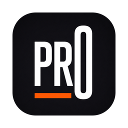
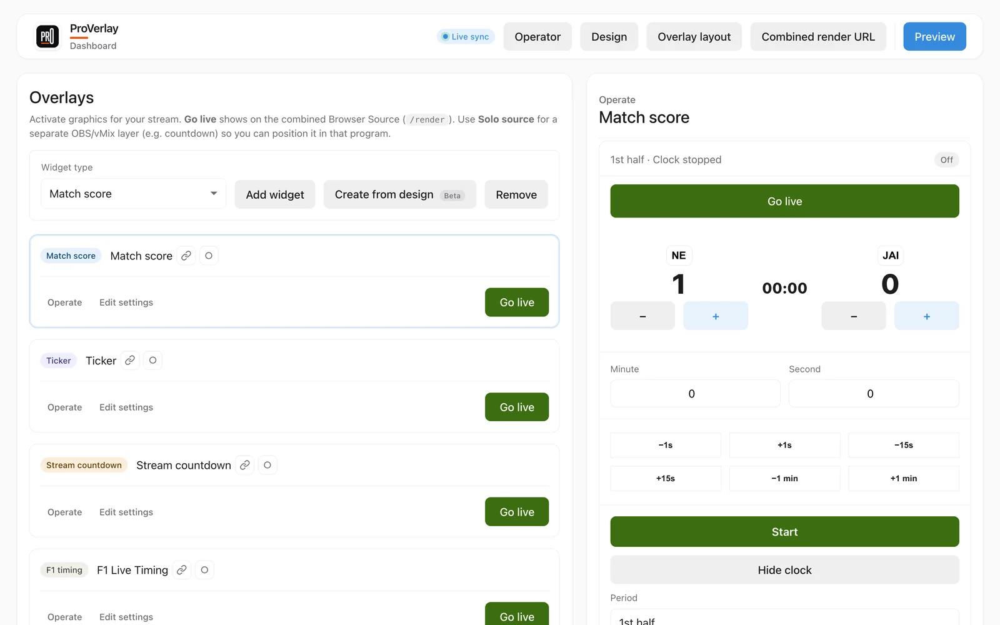

<p align="center">
  <a href="https://ferrywell.github.io/ProVerlay/"></a>
</p>

<h1 align="center">ProVerlay</h1>

<p align="center">
  <strong>Live broadcast graphics for OBS and vMix.</strong><br>
  Build overlays on your Mac or PC, operate them from an iPad or Stream Deck, play them out through one browser source.
</p>

<p align="center">
  <a href="https://ferrywell.github.io/ProVerlay/"><b>Website</b></a> ·
  <a href="https://github.com/Ferrywell/ProVerlay/releases/latest"><b>Download</b></a> ·
  <a href="https://github.com/Ferrywell/ProVerlay/releases">Releases</a> ·
  <a href="docs/USER-GUIDE.md">Docs</a>
</p>

<p align="center">
  <a href="https://github.com/Ferrywell/ProVerlay/releases/latest"></a>
  <a href="LICENSE"></a>
  
  
  
</p>

<p align="center">
  <a href="https://ferrywell.github.io/ProVerlay/"></a>
</p>

---

ProVerlay is a local tool for live graphics in streams and broadcasts: score bugs,
lower thirds, tickers, countdowns, a quiz and more. You set up the
graphics in a desktop dashboard, control them live from a phone, tablet or Stream
Deck, and OBS or vMix shows them through a transparent browser source. Everything
runs on your own machine and network — no account, no cloud.

## Features

- **Widgets:** match score (with optional PNG score strip), hockey scorebug, ticker,
  stream countdown, single lower third, lower-thirds roster, quiz, message, and an image
  widget for pre-designed PNG lower thirds, logos and sponsor boards.
- **One output URL** (`/render`) for all live widgets, plus a solo URL per widget
  (`/render?graphic=<id>`) when you want it on its own layer.
- **Touch operator** for iPad and iPhone over the local network.
- **Bitfocus Companion module** for Stream Deck, with automatic presets.
- **Projects** with their own branding (colours, fonts), assets and widgets; export
  and import as a single `.proverlay` file.
- **Scoreboard editor** to put live text fields on top of your own PNG design.
- **Data sources:** names, titles, ticker lines and quiz questions from Google Sheets,
  CSV or Excel, updated live and cached for offline use, plus `{{variables}}` in text.
- **REST API and Socket.io** for your own automation.
- **Desktop app** for macOS (Apple Silicon and Intel) and Windows (beta), with a
  menu-bar/tray icon; or run the server from source on any OS with Node.
- **Same output on every OS:** new projects use the bundled Inter font, so overlays look
  identical in OBS and vMix on a Mac and on a PC.

## How it works

```
┌─────────────────┐                ┌─────────────────┐
│  Dashboard      │                │  Operator       │
│  /control       │                │  /operator      │
│  setup + live   │                │  iPad / iPhone  │
└────────┬────────┘                └────────┬────────┘
         │        Socket.io (live sync)     │
         └──────────────┬───────────────────┘
                        │      Node server :2014
                        ▼
              ┌─────────────────┐
              │  Render         │  ← OBS Browser Source / vMix Web Browser
              │  /render        │    1920×1080, transparent
              └─────────────────┘
```

| Screen | URL | For |
|--------|-----|-----|
| Dashboard | http://localhost:2014/control | Desktop — projects, widgets, going live |
| Operator | http://localhost:2014/operator | Phone / tablet — scores, clock, toggles |
| Render | http://localhost:2014/render | OBS / vMix browser input |

A Node server (Express + Socket.io) on port **2014** keeps the state of the active
project and pushes every change to all connected screens. On a phone or tablet, `/`
opens the operator automatically.

## Download

From the [latest release](https://github.com/Ferrywell/ProVerlay/releases/latest):

| Platform | File | Status |
|----------|------|--------|
| macOS, Apple Silicon (M1 and later) | [`ProVerlay-mac-arm64.zip`](https://github.com/Ferrywell/ProVerlay/releases/latest/download/ProVerlay-mac-arm64.zip) | stable |
| macOS, Intel | [`ProVerlay-mac-x64.zip`](https://github.com/Ferrywell/ProVerlay/releases/latest/download/ProVerlay-mac-x64.zip) | stable |
| Windows 10/11, x64 | [`ProVerlay-win-x64-setup.exe`](https://github.com/Ferrywell/ProVerlay/releases/latest/download/ProVerlay-win-x64-setup.exe) | **beta** — not yet tested on much real hardware |
| Checksums | [`SHA256SUMS.txt`](https://github.com/Ferrywell/ProVerlay/releases/latest/download/SHA256SUMS.txt) | |

Check a download with `shasum -a 256 -c --ignore-missing SHA256SUMS.txt` (macOS) or
`Get-FileHash .\ProVerlay-win-x64-setup.exe -Algorithm SHA256` (Windows PowerShell).

### Mac app

1. Unzip and move `ProVerlay.app` to **Applications**.
2. The first time: **right-click → Open → Open**. If macOS still refuses:
   `xattr -cr /Applications/ProVerlay.app` (the app is ad-hoc signed, not notarized).

The dashboard opens in the app window; closing the window keeps the server running
for OBS/vMix. Quit from the menu-bar icon or with Cmd+Q.

### Windows app (beta)

1. Run `ProVerlay-win-x64-setup.exe`. It is not code-signed yet, so SmartScreen shows
   *"Windows protected your PC"*: click **More info → Run anyway**.
2. Keep **Only for me** (no administrator rights needed).
3. When Windows Defender Firewall asks, allow ProVerlay on **Private networks** so an
   iPad or Stream Deck on your network can connect. OBS/vMix on the same PC work
   either way.

The dashboard opens in the app window and ProVerlay lives in the notification area
(tray); click the icon to reopen the dashboard. Projects are kept in
`%APPDATA%\ProVerlay\data`, also when you uninstall. Port problems, firewall and
SmartScreen: [docs/USER-GUIDE.md](docs/USER-GUIDE.md#10-troubleshooting). More about
both apps in [docs/APP.md](docs/APP.md).

## Quick start — from source

Requires **Node 22** (see `.nvmrc`).

```bash
git clone https://github.com/Ferrywell/ProVerlay.git
cd ProVerlay
nvm use        # or install Node 22 another way
npm ci
npm start      # → http://localhost:2014/control
```

`npm run dev` restarts the server on file changes; `npm run app` runs the Electron
app from your working copy.

## OBS / vMix

| | OBS | vMix |
|-|-----|------|
| Input | Browser source | Add Input → More → Web Browser |
| URL | `http://127.0.0.1:2014/render` | `http://127.0.0.1:2014/render` |
| Size | 1920 × 1080 | 1920 × 1080 |

The page is transparent. Use the machine's IP instead of `127.0.0.1` when ProVerlay
runs on another computer. Details, solo layers and troubleshooting:
[docs/OBS-VMIX.md](docs/OBS-VMIX.md).

## Operator on iPad

Put the iPad on the **same Wi-Fi** as the computer running ProVerlay and open
`http://<computer-ip>:2014/operator` (http, not https). The dashboard lists the right
addresses under **Project & network → Network**.

## Companion (Stream Deck)

The [`companion/`](companion/) folder contains a Bitfocus Companion module (Companion
4.3+): show/hide graphics on the main or solo output, scores, match clock,
countdowns, speakers and automatic presets. Host `127.0.0.1`, port `2014`.
Install: [companion/README.md](companion/README.md) · Reference:
[docs/COMPANION.md](docs/COMPANION.md).

## Projects: export and import

Each project holds its widgets, branding and assets. **Project & network → Export**
saves the active project as a `.proverlay` file (a zip); **Import** adds it as a new
project on another machine. Imported projects are not activated until you click
**Activate this project**.

## Platforms

- **Server and browser UIs:** run anywhere Node 22 runs (macOS, Windows, Linux).
- **Desktop app:** macOS on Apple Silicon and Intel; Windows 10/11 x64 as a per-user
  installer. Windows is **beta** until it has been tested on more real hardware —
  please report problems in the [issues](https://github.com/Ferrywell/ProVerlay/issues).
- **Output:** OBS (macOS, Windows) and vMix (Windows). The render uses the bundled
  Inter font by default, so the same project looks the same on every OS.

## Where your data lives

| How you run it | Location |
|----------------|----------|
| From source | `data/` in the repository — created on first start, gitignored |
| Mac app | `~/Library/Application Support/ProVerlay/data` |
| Windows app | `%APPDATA%\ProVerlay\data` |
| Custom | set `PROVERLAY_DATA_DIR` |

New installs start with one blank project. Bundled brand presets live in
[`templates/brands/`](templates/brands/); your own presets go in `data/brands/`.

## Security

ProVerlay is a LAN tool with **no authentication**. The server listens on all network
interfaces on port 2014, so anyone who can reach that port can view and control your
graphics. Run it on a network you trust, and do not expose port 2014 to the internet.
See [SECURITY.md](SECURITY.md) for details and how to report a vulnerability.

## Documentation

| Document | Contents |
|----------|----------|
| [User guide](docs/USER-GUIDE.md) | First show, step by step, plus troubleshooting |
| [OBS and vMix](docs/OBS-VMIX.md) | Browser input setup, transparency, performance |
| [Data sources](docs/DATA-SOURCES.md) | Google Sheets, CSV, Excel and `{{variables}}` |
| [Desktop app](docs/APP.md) | Mac and Windows app, preferences, data folders, building the app |
| [Companion](docs/COMPANION.md) | Stream Deck actions, feedbacks, presets |
| [Architecture](docs/ARCHITECTURE.md) | Server, state, API |
| [Product overview](docs/PRODUCT.md) | Screens, widget types, scope |
| [Match graphics](docs/ARCHITECTURE-MATCH-GRAPHICS.md) | Score strip model and roadmap |
| [Design input](docs/DESIGN-INPUT.md) · [PNG workflow](docs/DESIGN-PNG-WORKFLOW.md) | Bringing your own designs |
| [UX brief](docs/UX-DESIGN-BRIEF.md) | Design direction for the control UIs |
| [Manual test plan](docs/QA-TEST-PLAN.md) | Release checklist |
| [Changelog](CHANGELOG.md) | Version history |

## Project structure

```
ProVerlay/
├── server/            # Express API, Socket.io, state and projects
├── public/control/    # Dashboard
├── public/operator/   # Touch operator
├── public/render/     # Output page for OBS/vMix
├── public/editor/     # Scoreboard editor
├── public/shared/     # Shared UI code and design tokens
├── electron/          # Desktop app shell (macOS, Windows)
├── companion/         # Bitfocus Companion module (MIT)
├── templates/brands/  # Bundled brand presets
├── docs/              # Documentation
└── data/              # Your local projects (gitignored, created on first start)
```

## Contributing

Contributions are welcome — bug reports, fixes, docs and new widgets. Read
[CONTRIBUTING.md](CONTRIBUTING.md) for the development setup and pull-request
workflow, and follow the [Code of Conduct](CODE_OF_CONDUCT.md).

## License

Copyright (C) 2026 ProductionPro

ProVerlay is free software: you can redistribute it and/or modify it under the terms
of the **GNU General Public License version 3** as published by the Free Software
Foundation. It is distributed in the hope that it will be useful, but WITHOUT ANY
WARRANTY. See [LICENSE](LICENSE) for the full text.

The Companion module in [`companion/`](companion/) is licensed separately under the
[MIT license](companion/LICENSE), as required for the Bitfocus module store.

The bundled [Inter](https://github.com/rsms/inter) font in
[`public/shared/fonts/`](public/shared/fonts/) is © The Inter Project Authors and
licensed under the [SIL Open Font License 1.1](public/shared/fonts/OFL.txt).
